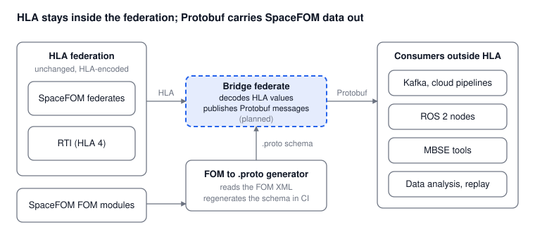

<div align="center">

# SpaceFOM ⇄ Protobuf

**A Protocol Buffers schema for the SISO SpaceFOM datatypes, generated from the FOM modules,<br>so cloud, streaming, robotics and MBSE tools can read space-simulation data without speaking HLA.**

[](LICENSE)
[](proposal/pitch.md)
[](https://ntrs.nasa.gov/citations/20260008222)
[](https://cdn.ymaws.com/www.sisostandards.org/resource/resmgr/standards_products/siso-std-018-2020_srfom.pdf)



</div>

## What this is

[SpaceFOM](https://cdn.ymaws.com/www.sisostandards.org/resource/resmgr/standards_products/siso-std-018-2020_srfom.pdf) (SISO-STD-018-2020) is the SISO standard for interoperable, HLA-based space-mission simulation, now being evolved into **SpaceFOM 2.0** by the SISO Product Development Group.

Today, SpaceFOM data can only be read by software that speaks HLA. This project proposes that SpaceFOM 2.0 also publish a `.proto` schema of its datatypes, generated mechanically from the FOM XML, plus a reference bridge federate that republishes HLA updates as Protobuf on Kafka or gRPC.

Federation roles, synchronization and time management stay in HLA; the schema is for tools outside the federation.

## Read the proposal

| Document | What it is |
|---|---|
| **[One-page pitch](proposal/pitch.md)** | Problem, solution, expected benefits, proposer: the summary for the SpaceFOM 2.0 PDG |
| [Draft PCR](proposal/pcr-draft.md) | The proposal on the SISO Problem/Change Request form (SISO-ADM-003, Appendix A) |
| [Technical briefing for the hearing](docs/hearing/technical-briefing.md) | How the proposal works, with diagrams: architecture, generator pipeline, the path of one update, field numbering |
| [Open questions for the PDG](proposal/open-questions.md) | Every decision the proposal needs from the PDG, with context |
| [Reference repository proposal](proposal/reference-repository.md) | Where the schema, generator and multi-language samples should live if the PDG adopts them: options and the decisions needed |
| [Technical overview](docs/technical-overview.md) | HLA-to-Protobuf mapping, example `.proto`, architecture |
| [Verification](docs/verification.md) | Every technical claim, with the clause of the standard it was checked against |
| [Generator and CI plan](docs/plans/generator-ci-plan.md) | Approved plan for the FOM XML → `.proto` generator and the GitHub Action that opens update PRs |
| [Generated schema](proto/siso/spacefom/v1/) | The `.proto` files generated from the SpaceFOM 1.0 FOM modules, package `siso.spacefom.v1` |
| [Samples](samples/README.md) | Generated code, a reader program and tests in C++, Python, Java, C#, TypeScript and Go, and the two-workflow pipeline that keeps them in step with the FOM |

## Example

`ReferenceFrame`, as defined in SISO-STD-018-2020 (Tables C-4 to C-7, C-13), rendered as Protobuf. Full file: [docs/examples/reference_frame.proto](docs/examples/reference_frame.proto).

```protobuf
message SpaceTimeCoordinateState {
  ReferenceFrameTranslation translational_state = 1;
  ReferenceFrameRotation rotational_state = 2;
  double time = 3;  // Time: simulated physical time (TT), s
}

message ReferenceFrame {
  optional string name = 1;
  optional string parent_name = 2;  // empty for the root frame
  optional SpaceTimeCoordinateState state = 3;
}
```

## Roadmap

- [x] Proposal, draft PCR and verified example schema
- [x] FOM XML → `.proto` generator, with CI
- [x] Generated code, samples and tests in six languages
- [ ] Bridge federate: HLA updates → Protobuf → Kafka / gRPC
- [ ] Docker Compose demo: sample federation, bridge and non-HLA consumers
- [ ] Technical documentation and diagrams for the PDG hearing (first version: [technical briefing](docs/hearing/technical-briefing.md))

## Generating the schema

The generator is plain Python 3.11 and needs no XML library beyond the standard one. It downloads the four SISO FOM modules from the [nasa/TrickHLA][trickhla] commit pinned in [`fom/SOURCE.json`](fom/SOURCE.json), checks their sha256, and writes `proto/`:

```sh
pip install -r generator/requirements.txt
export PYTHONPATH=generator
python -m spacefom_proto fetch --dest build/fom
python -m spacefom_proto generate --fom-dir build/fom
python -m pytest generator/tests
```

`generate --check` writes nothing and fails if the committed files are out of date. `--no-semantics` leaves the FOM's `<semantics>` text out of the comments, and `--no-interactions` leaves out `ModeTransitionRequest`. Field numbers are kept stable by [`generator/field-ids.lock.json`](generator/field-ids.lock.json) (see [Field numbers](docs/technical-overview.md#field-numbers)).

### Triggering the generation in CI

The [`generate-proto`](.github/workflows/generate-proto.yml) workflow runs the same steps on GitHub. What it does depends on how it starts:

| Trigger | What happens |
|---|---|
| Push to `main` that changes `fom/`, `generator/`, `buf.yaml` or the workflow | Regenerates, runs the tests, `buf lint` and `buf breaking`. If the output changed, it copies the previous tree into `history/` and opens (or updates) a pull request from `generator/proto-update` |
| Push to any other branch, same paths | The same run as a dry run: it reports what would change and never opens a pull request |
| Pull request | Check only: fails if the committed `proto/` or lock file is out of date |
| Manual run | Same as a push to the branch you pick; tick `dry_run` to skip the pull request on `main` |

To update the schema to a newer FOM, edit [`fom/SOURCE.json`](fom/SOURCE.json) (the upstream commit and the sha256 of each file) and merge that change into `main`. The workflow then opens the pull request with the regenerated files.

To start a run by hand, open Actions → generate-proto → Run workflow, or use the GitHub CLI:

```sh
gh workflow run generate-proto --ref main                # regenerate and open a PR if anything changed
gh workflow run generate-proto --ref main -f dry_run=true # report only
gh run watch                                               # follow the run
```

The pull request is opened with the repository's `GITHUB_TOKEN`, so workflows do not run on it again; the checks have already passed inside the generating run.

## Repository layout

```
proposal/    one-page pitch and draft PCR
tools/       render_pdf.py: turns a Markdown doc into HTML, PDF and Word (pandoc, Chrome, librsvg)
docs/        technical overview, verification, plans, diagrams, example .proto
fom/         SOURCE.json: pinned upstream commit and sha256 of each FOM module
generator/   the FOM XML -> .proto generator, its tests and the field-number lock file
proto/       generated .proto files (do not edit by hand)
history/     earlier generated trees, added by CI when the output changes
samples/     generated code and tests in six languages (see samples/README.md)
```

[trickhla]: https://github.com/nasa/TrickHLA/tree/master/FOMs/SpaceFOM

## Disclaimer

Independent proposal by [Gian Paolo Santopaolo](https://github.com/gsantopaolo). Not affiliated with, endorsed by, or an official product of SISO, NASA or any other organization. SpaceFOM and SISO-STD-018-2020 are © SISO; this repository does not reproduce the standard and refers to it by clause. The `.proto` definitions are derived works of the SpaceFOM FOM modules, and the generated files copy the modules' `<semantics>` text into comments: Reprinted with permission from SISO Inc. Whether that text falls under SISO's "Schema" or "Documentation" licence is an [open question for the PDG](proposal/open-questions.md#sources-and-licence).

Prepared with Claude (Anthropic) as a research and drafting aid; every technical fact was checked against the primary sources listed in [verification](docs/verification.md).

## License

[MIT](LICENSE) © 2026 Gian Paolo Santopaolo
