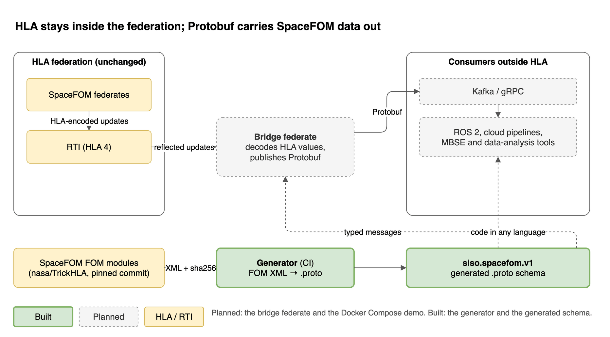
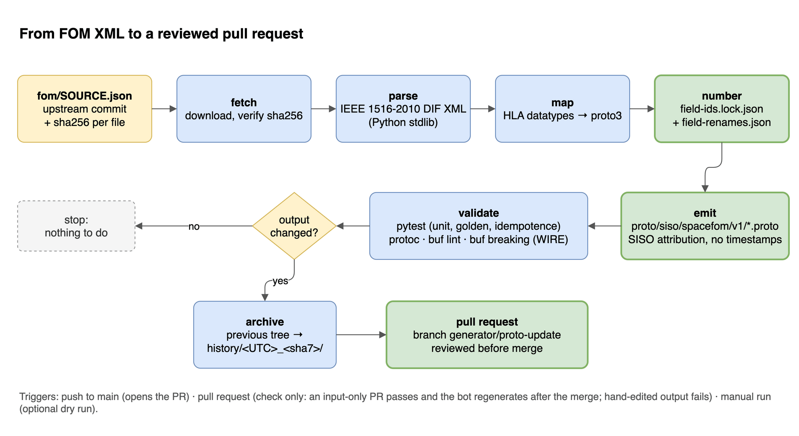
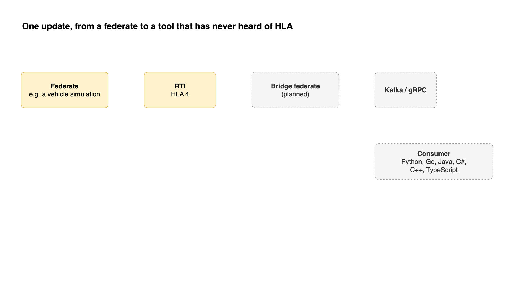
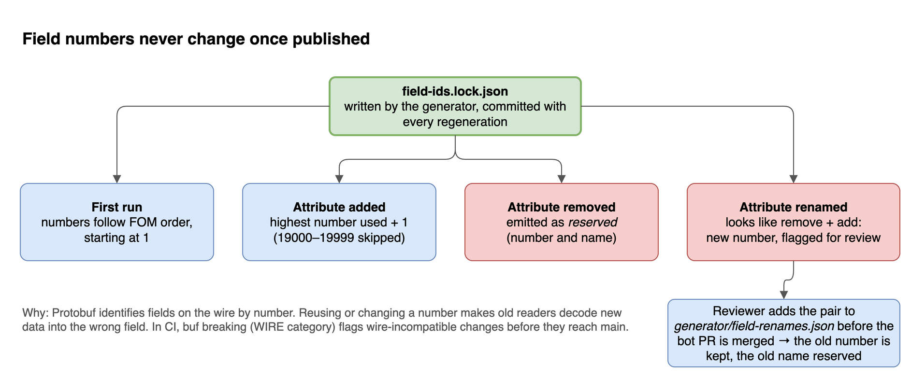

# Technical briefing for the SpaceFOM 2.0 PDG hearing

How the proposal in the [one-page pitch](../../proposal/pitch.md) works, what is built and what is planned. Every claim about the standard is cited in [verification](../verification.md).

## Contents

- [The ask](#the-ask)
- [Architecture](#architecture)
- [How the schema is produced](#how-the-schema-is-produced)
- [What happens to one update](#what-happens-to-one-update)
- [Keeping the schema wire-compatible](#keeping-the-schema-wire-compatible)
- [What is built and what is planned](#what-is-built-and-what-is-planned)
- [Diagram sources](#diagram-sources)

## The ask

Publish, alongside the SpaceFOM 2.0 FOM modules, a Protocol Buffers schema of the SpaceFOM datatypes and object classes, generated from the FOM XML. HLA stays the exchange mechanism inside the federation. The schema lets tools outside it (Kafka, cloud pipelines, ROS 2, MBSE and data-analysis tools) read SpaceFOM data with generated code in their own language. The decisions this needs from the PDG are in [open questions](../../proposal/open-questions.md).

## Architecture

The federation does not change. Two parts are new. The generator turns the FOM modules into the `siso.spacefom.v1` schema; it is built and runs in CI. The bridge federate joins the federation, receives updates and republishes them as Protobuf; it is planned.

## How the schema is produced

1. `fom/SOURCE.json` pins the FOM modules to a commit of nasa/TrickHLA and records the sha256 of each file. The generator refuses any file whose hash differs.
2. The parser reads the IEEE 1516-2010 DIF XML with the Python standard library.
3. The mapper applies the rules in the [mapping table](../technical-overview.md#mapping): `HLAfloat64LE` to `double`, fixed records to messages, enumerations to enums, object classes to messages with optional fields.
4. Field numbers come from a committed lock file (next section).
5. The emitter writes one `.proto` file per FOM module, with the SISO attribution and the input hashes in the header and no timestamps, so two runs give identical bytes.
6. CI validates the output: unit, golden and idempotence tests, `protoc`, `buf lint` and `buf breaking`. If the output changed on `main`, it archives the previous tree under `history/` and opens a pull request for review.

From the SpaceFOM 1.0 modules the generator produces four files (`datatypes`, `environment`, `entity`, `management`). Its 27 tests pass, and a workflow [dry run](https://github.com/gsantopaolo/spacefom2-protobuf/actions/runs/44079591250) on 17 November 2026 ran every validation step; it skipped archiving and opening the PR, as dry runs and runs without changes do.

## What happens to one update

Even with HLA 4's Federate Protocol, which defines its services in Protobuf, each attribute value is carried as an opaque `bytes` field holding HLA-encoded data (`AttributeHandleValue.value` in the Federate Protocol `datatypes.proto`). A tool that reads those bytes still needs the FOM and an HLA decoder. The bridge does that decoding once, so consumers don't have to.

The TT time tag is inside every state, so it reaches the consumer bit for bit. The bridge is time constrained, so it receives each update's HLA time stamp in order, but not time regulating, so it cannot slow the federation. Where the schema puts the time stamp is still open. Details and the open points (Q9, Q12, Q13): [time in SpaceFOM data](../time.md).

## Keeping the schema wire-compatible

Protobuf identifies fields by number, so a published number must never change or be reused. The generator does not derive numbers from FOM order. A committed lock file records them: new attributes get the next free number, removed ones become `reserved`, and a rename gets a new number unless a reviewer maps it to the old one in `generator/field-renames.json` before the bot's pull request is merged. `buf breaking` with the WIRE category checks the schema on pull requests that touch it and on every regeneration.

## What is built and what is planned

| Part | Status |
|---|---|
| Mapping rules, verified against SISO-STD-018-2020 | Done ([verification](../verification.md)) |
| Generator, lock file, generated `siso.spacefom.v1` schema | Done, in `generator/` and `proto/` |
| CI workflow: check on pull requests, regenerate and open a PR on `main` | Done, tested end to end on 17 November 2026: a generator change led to bot PRs [#22](https://github.com/gsantopaolo/spacefom2-protobuf/pull/22) (schema) and [#23](https://github.com/gsantopaolo/spacefom2-protobuf/pull/23) (samples) |
| Samples: generated code, a reader and tests in C++, Python, Java, C#, TypeScript and Go, regenerated by a second workflow | Done, in [`samples/`](../../samples/) |
| Bridge federate | Planned |
| Docker Compose demo: RTI, simulated federates, bridge, Kafka and non-HLA consumers | Planned; scenario and RTI depend on the PDG ([Q8](../../proposal/open-questions.md#demo)) |

## Diagram sources

The diagrams are draw.io files in [`docs/diagrams/`](../diagrams/). Edit them in [draw.io](https://www.drawio.com), then run `docs/diagrams/export.sh` to regenerate the GIFs. A diagram with several layers becomes an animated GIF that adds one layer per frame, as in the data-path diagram.
