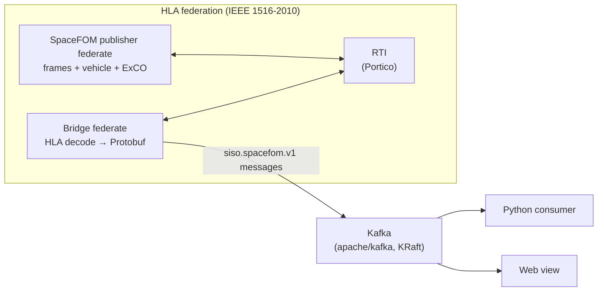

# Plan: a one-command Docker demo of the SpaceFOM-to-Protobuf bridge

Status: **draft for review**. Nothing here is built yet. Decisions are marked **[E1]…[E6]** and collected at the end. The PDG's own preferences are asked in [Q8 of the open questions](../../proposal/open-questions.md#demo).

## Goal

`docker compose up` starts a small SpaceFOM federation and shows its data leaving HLA as Protobuf. A reviewer sees reference frames and a moving vehicle arrive in tools that know nothing about HLA. This is the "working demo" the [pitch](../../proposal/pitch.md) offers to present.

## What the research found

I checked these sources on 2026-11-17.

- The existing SpaceFOM federates need commercial RTIs. TrickHLA's build stops unless `RTI_VENDOR` is `Pitch_HLA_4`, `Pitch_HLA_Evolved` or `MAK_HLA_Evolved` ([`S_hla.mk` L55–76](https://github.com/nasa/TrickHLA/blob/c7bce7d63857642d964dd464471f6c120d003853/makefiles/S_hla.mk#L55-L76)). The SEE HLA Starter Kit v2.1.0 is "tested on Pitch pRTI" ([repo](https://github.com/SEI-Lab-Unical/SEE-HLA-Starter-Kit)), and the archived [Vega](https://github.com/atreia108/vega) credits Pitch licences.
- The free editions of those RTIs are unlikely to fit a public image. The research agent reported that MAK's free mode is limited to two federates and not for deployed systems ([MAK bonus page](https://www.mak.com/bonus)), but the page did not render when I re-checked it, so this is unverified. The Pitch pRTI Free terms could not be checked either (pitch.se now redirects to onearc.com).
- Portico is open source and supports IEEE 1516e. Its README says it is released under CDDL, "which means you can repackage and redistribute it with your applications" ([README](https://github.com/openlvc/portico/blob/fcae8013d183308d34d06fc1b379e630969aca3f/README.md)). It supports "IEEE-1516e: Java and C++". Release 2.1.4 is dated 2026-03-02. The Java encoders the bridge needs exist: `HLA1516eFloat64LE`, `HLA1516eFixedRecord`, `HLA1516eFixedArray` and `HLA1516eUnicodeString` ([source](https://github.com/openlvc/portico/tree/fcae8013d183308d34d06fc1b379e630969aca3f/codebase/src/java/portico/org/portico/impl/hla1516e/types/encoding)). There is no HLA 4 support.
- OpenRTI (LGPL or MPL) also supports 1516e and has a standalone server, but its Python binding has no `HLAfloat64LE` or fixed-record encoders. That finding comes from the research agent and has not been re-checked.
- Kafka has an official image, `apache/kafka:4.4.0`, with amd64 and arm64 builds (Docker Hub tags API), and a single-node KRaft mode ([quickstart](https://kafka.apache.org/quickstart)).

A public, one-command demo therefore needs a small SpaceFOM federate written for this project, running on Portico. The same bridge could also run against TrickHLA or the SEE kit in a private demo with a licensed RTI; Q8 now asks the PDG about that.

## Proposed stack

| Container | Contents |
|---|---|
| `rti` | Portico 2.1.4, built from its source release on a pinned JDK image |
| `publisher` | A Java 1516e federate that loads the four SpaceFOM FOM modules (fetched by sha256 from `fom/SOURCE.json`). It acts as Master Federate: it publishes `ExecutionConfiguration` (moving through `EXEC_MODE_INITIALIZING` → `EXEC_MODE_RUNNING`), a root frame and an Earth-centred frame (`ReferenceFrame`), and one `DynamicalEntity` in a circular orbit, updated at a fixed rate with time-stamped updates |
| `bridge` | A Java 1516e federate that subscribes to those classes and decodes the attributes with Portico's encoders. It builds the generated `siso.spacefom.v1` messages (Java bindings from `samples/generated/java`) and writes them to Kafka, one topic per class, keyed by object instance name (how the schema itself identifies the instance is [open question Q9](../../proposal/open-questions.md#schema-design)) |
| `kafka` | `apache/kafka:4.4.0`, single-node KRaft |
| `consumer-python` | Uses the Python bindings from `samples/generated/python` and prints each update as JSON |
| `web` | A small page that plots the vehicle's position, fed over a WebSocket by a tiny Node service using the TypeScript bindings **[E5]** |

Writing both federates in Java keeps the demo to one toolchain, lets the bridge use Portico's own encoders, and uses `protobuf-java` for the Kafka side.

## Testing

- The bridge's HLA → Protobuf conversion is unit-tested without an RTI: encode with Portico's encoders, decode, and compare with expected messages, including the edge cases the samples already cover (empty `parent_name` present, unset attributes absent, 9-element inertia).
- An end-to-end test brings the stack up in CI, waits for N messages per topic in the Python consumer, checks their values against the publisher's known orbit, and tears the stack down.
- All images and dependencies are pinned (image digests, Maven versions, action SHAs).

## Phases

| Phase | Work |
|---|---|
| 1 | Portico container; publisher federate joining a federation with the four SpaceFOM modules; arm64 check **[E6]** |
| 2 | Bridge federate with unit tests; Kafka; Python consumer |
| 3 | Web view **[E5]**; end-to-end CI job; `demo/README.md` with the diagram and a one-command quick start |
| 4 | Docs (README, overview, pitch "Implementation status" link); humanizer pass |

## Risks

- I have not checked how Portico federates find each other on a Docker network. Phase 1 tests that first.
- No open HLA 4 Federate Protocol stack is complete, so the demo uses the HLA Evolved API. HLA 4 is a later step.
- Portico depends on one upstream project. If it stops being maintained, we keep working from the pinned 2.1.4 source, which we build ourselves.

## Decisions

- **E1** RTI: Portico 2.1.4 (recommended), or OpenRTI?
- **E2** Federates: a small publisher written for this project (recommended, publicly redistributable), or also a private variant using TrickHLA with a licensed Pitch or MAK RTI?
- **E3** Bridge language: Java (recommended: Portico encoders, one toolchain), or C++?
- **E4** Transport: Kafka only, or Kafka plus a gRPC stream?
- **E5** Web view in v1, or Python consumer only?
- **E6** Must the demo run on Apple Silicon (arm64) on day one?
- Out of scope for v1: the inbound direction (outside tool → Protobuf → HLA), which Q8 asks the PDG about.
