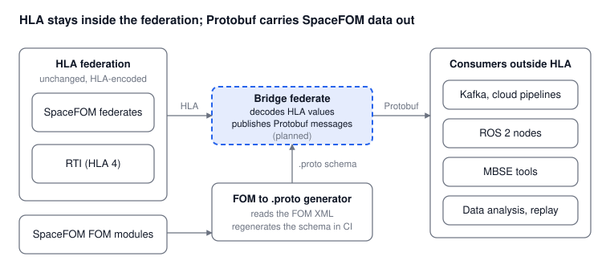

# Technical overview: SpaceFOM datatypes as Protocol Buffers

Companion to the [one-page pitch](../proposal/pitch.md) and the [draft PCR](../proposal/pcr-draft.md). Every datatype, field name and encoding below was checked against SISO-STD-018-2020 and the SpaceFOM 1.0 FOM XML; see [verification](verification.md).

## Contents

- [Where it fits](#where-it-fits)
- [Encoding today](#encoding-today)
- [Mapping](#mapping)
- [Field numbers](#field-numbers)
- [Example output](#example-output)
- [What the schema does not carry](#what-the-schema-does-not-carry)
- [SpaceFOM 2.0 changes the generator must follow](#spacefom-20-changes-the-generator-must-follow)
- [What SpaceFOM 2.0 needs from the generator](#what-spacefom-20-needs-from-the-generator)
- [References](#references)

## Where it fits

The federation is untouched. Two parts are new:

- Generator: reads the SpaceFOM FOM modules (IEEE 1516-2010 DIF XML) and writes `.proto` files. It runs in CI, so the schema is regenerated whenever the FOM changes.
- Bridge federate: joins the federation like any other federate (classic HLA API, or the HLA 4 Federate Protocol), reflects SpaceFOM object updates, converts them to the generated Protobuf messages and publishes them to Kafka or gRPC.

Out of scope: replacing HLA, its RTI services, federate roles, synchronization or time management.

## Encoding today

SpaceFOM uses Little Endian everywhere except HLA logical time (`HLAinteger64Time`, whose underlying representation `HLAinteger64BE` is Big Endian) (SISO-STD-018-2020 §8.7.3). Its datatypes are built on four basic representations (§8.7.2.1):

| Basic representation | Used for |
|---|---|
| `HLAfloat64LE` | All simple datatypes: `Length`, `Velocity`, `Time`, `Mass`, `Scalar`, … (Table 8-2) |
| `HLAinteger16LE` | Enumerations `ExecutionMode`, `MTRMode` (Tables C-10, C-11) |
| `HLAinteger64Time` | HLA logical time and lookahead |
| `HLAunicodeString` | Names and identifiers (e.g. `ReferenceFrame.name`, `PhysicalEntity.parent_reference_frame`) |

HLA 4's Federate Protocol does not change this. Its Protobuf messages carry each attribute or parameter value as an opaque `bytes` field (`AttributeHandleValue.value`, `ParameterHandleValue.value` in the IEEE 1516.1 Federate Protocol `datatypes.proto`, reprinted with permission from IEEE 1516.1(TM)-2024), so a consumer still needs the FOM and an HLA decoder to read the data.

Aggregates are `HLAfixedArray` (3-vectors and 3×3 matrices, Table C-3) and `HLAfixedRecord` (Tables C-4 to C-7). SpaceFOM 1.0 defines no variant records (§8.7.2.6).

## Mapping

| HLA OMT construct | Protobuf | Notes |
|---|---|---|
| `HLAfloat64LE` simple datatype | `double` | Unit from the FOM `<units>` element, copied as a comment |
| `HLAinteger64Time` | `int64` | SpaceFOM 1.0: microseconds since the start of the federation execution (FOM `<time>` semantics); configurable resolution in 2.0 |
| `HLAinteger16LE` enumeration | `enum` | Enumerator names and values kept as in the FOM. proto3 needs a first value of zero, so an enumeration without one gets `<NAME>_UNSPECIFIED = 0` (`MTRMode` starts at 2 and gets `MTR_MODE_UNSPECIFIED`) |
| `HLAunicodeString` | `string` | |
| `HLAfixedArray`, cardinality 3 | message with `x`, `y`, `z` | One message per named array type (`PositionVector`, `VelocityVector`, …), so types stay distinct |
| `HLAfixedArray`, cardinality 9 | `repeated double` (9 elements) | `InertiaMatrix`, `Matrix`, `InertiaRateMatrix`. The array type's `<semantics>`, which gives the element order, is copied as a comment on each field of that type. A `repeated` field cannot also be `optional`; an empty list means the attribute was not sent. Whether each matrix type should become a message is [Q10](../proposal/open-questions.md#schema-design) |
| `HLAfixedRecord` | `message` | Field order preserved |
| Variant record (none in 1.0) | `oneof` | For SpaceFOM 2.0 / HLA 4 `HLAextendableVariantRecord` if adopted |
| Object class | `message`, all attributes `optional` | A partial attribute update maps to a partial message (see [what the schema does not carry](#what-the-schema-does-not-carry)) |
| Object subclass (`DynamicalEntity` of `PhysicalEntity`) | Flat `message` | The parent's attributes come first, in FOM order, then the subclass's own |
| Interaction class | `message` | Generated by default; a generator flag leaves it out |
| `<semantics>` | Comment on the message or field | Words kept verbatim, whitespace re-wrapped. The semantics of the simple datatypes (for example `Length`: "A scalar length.") are not copied yet. A generator flag leaves all of it out ([open questions, Q5](../proposal/open-questions.md#sources-and-licence)) |

## Field numbers

Protobuf identifies a field on the wire by its number, so the number "cannot be changed once your message type is in use" and "should never be reused" ([proto3 guide][proto3]). The generator therefore does not derive numbers from the field's position in the FOM. It keeps them in a committed lock file, [`generator/field-ids.lock.json`](../generator/field-ids.lock.json):

- On the first run, numbers follow FOM order from 1, which reproduces the [example](#example-output).
- A new field gets the highest number used so far plus one, skipping 19000 to 19999, which protobuf reserves for itself.
- A field that disappears from the FOM is emitted as `reserved` (number and name), so nobody can reuse it.
- The generator cannot tell a renamed field from a deleted one plus a new one, so a rename gets a new number and the update PR lists it for review. To keep the old number, a reviewer adds the pair to `generator/field-renames.json` (`{"Message": {"new_name": "old_name"}}`) in a pull request before the bot's PR for the rename is merged. The renamed field then keeps the old number, and the old name is reserved. If the new name already has a different number in the lock file, the generator stops with an error instead of ignoring the entry.

The lock file is generator output: only the generator writes it, and a pull request that edits it by hand fails its check. `generator/field-renames.json` is an input that reviewers edit.

The generated files are in [`proto/siso/spacefom/v1/`](../proto/siso/spacefom/v1/), one per FOM module. How they are built and checked is in the [generator and CI plan](plans/generator-ci-plan.md).

## Example output

[`examples/reference_frame.proto`](examples/reference_frame.proto) is `ReferenceFrame` and the types it depends on, written by hand from SISO-STD-018-2020 (Tables C-4 to C-7, C-13) and `SISO_SpaceFOM_datatypes.xml`. It compiles with `protoc`, and the generator's golden test checks that the generated schema has the same messages, field names, numbers, types and labels.

## What the schema does not carry

A consumer of one message cannot tell which object instance it describes, when it was produced, or whether the instance still exists. The schema has no field for the instance an update belongs to, for its HLA time stamp, or for the removal of an instance. `name` does not fill the gap: in the FOM it is a Static attribute ([`SISO_SpaceFOM_entity.xml` L74–76](https://github.com/nasa/TrickHLA/blob/ed05f1b2f0bada22fffe12c1d5d5b551bbcfa91b/FOMs/SpaceFOM/SISO_SpaceFOM_entity.xml#L74-L76)), so a partial update does not carry it. Whether the answer is an envelope message around each update or a bridge that always sends full state is [open question Q9](../proposal/open-questions.md#schema-design).

## SpaceFOM 2.0 changes the generator must follow

From the SISO SIMposium 2026 presentation "SpaceFOM V2 … and How You Can Help":

- configurable time resolution (`BASE_TIME_SECONDS` … `BASE_TIME_ATTOSECONDS`) and an updated epoch (2000);
- HLA 4 directed interactions and the new `Reference` datatype;
- extended object classes drawn from NASA Artemis and ESA HRAF3 experience.

Because the schema is generated from the FOM, each of these changes becomes a rule in the generator; nobody edits the `.proto` files by hand.

## What SpaceFOM 2.0 needs from the generator

The generator is proven on the four SpaceFOM 1.0 modules only. At commit `baeda12` it has these limits:

- It reads only the IEEE 1516-2010 namespace ([`parse.py` L22](https://github.com/gsantopaolo/spacefom2-protobuf/blob/baeda12/generator/spacefom_proto/parse.py#L22), [L51](https://github.com/gsantopaolo/spacefom2-protobuf/blob/baeda12/generator/spacefom_proto/parse.py#L51)). An HLA 4 FOM needs the IEEE 1516-2025 namespace, which has not been checked yet.
- It accepts only files named `SISO_SpaceFOM_<key>.xml` ([`parse.py` L26](https://github.com/gsantopaolo/spacefom2-protobuf/blob/baeda12/generator/spacefom_proto/parse.py#L26)), so renamed 2.0 modules or a mission's extension modules need a code change.
- It stops on any variant record ([`parse.py` L62–64](https://github.com/gsantopaolo/spacefom2-protobuf/blob/baeda12/generator/spacefom_proto/parse.py#L62-L64)). HLA 4 adds `HLAextendableVariantRecord` ([verification](verification.md)); the mapping table plans `oneof` for it, and the generator still has to implement that.
- It has no rule for the HLA 4 `Reference` datatype. The rule can be written once a 2.0 FOM draft defines the type.
- It writes the fixed package `siso.spacefom.v1` and a fixed attribution naming SISO-STD-018-2020 ([`emit.py` L12](https://github.com/gsantopaolo/spacefom2-protobuf/blob/baeda12/generator/spacefom_proto/emit.py#L12), [L17–20](https://github.com/gsantopaolo/spacefom2-protobuf/blob/baeda12/generator/spacefom_proto/emit.py#L17-L20)). For 2.0 the package, the attribution and the file-name pattern should come from configuration such as `fom/SOURCE.json`, following the package versioning the PDG chooses ([Q6](../proposal/open-questions.md#naming-and-hosting)).

There is also no path yet for a breaking change the PDG intends. `buf breaking` runs with the `WIRE` category, which includes `FIELD_WIRE_COMPATIBLE_TYPE` ([buf breaking rules](https://buf.build/docs/breaking/rules/)), so a pull request that changes an attribute's datatype to a wire-incompatible one fails its check. One way through is a new package, for example `siso.spacefom.v2` in its own directory, published next to `v1` so existing consumers keep working. That needs a generator change and the PDG's versioning decision.

[proto3]: https://protobuf.dev/programming-guides/proto3/

## References

1. [SISO-STD-018-2020, Space Reference FOM (SpaceFOM) 1.0](https://cdn.ymaws.com/www.sisostandards.org/resource/resmgr/standards_products/siso-std-018-2020_srfom.pdf)
2. [SpaceFOM 1.0 FOM modules (XML)](https://github.com/nasa/TrickHLA/tree/master/FOMs/SpaceFOM), as distributed in NASA TrickHLA
3. Möller, Karlsson et al., ["A Summary of Technical Updates in HLA 4 (IEEE 1516-2025)"](https://onearc.com/wp-content/uploads/2026/02/SISO_2026_SIW_028.pdf), SISO SIW 2026, paper 028
4. Crues, Möller, Garro, Dexter, ["SpaceFOM V2: The Next Generation in Space Simulation Interoperability and How You Can Help"](https://ntrs.nasa.gov/citations/20260008222), SISO SIMposium, Sept 2026
5. Möller et al., ["Evolving the SpaceFOM: Lessons Learned and Future Development"](https://ntrs.nasa.gov/api/citations/20250000915/downloads/SISO_2025_SIW_SpaceFOM_Paper.pdf), SISO SIW 2025
6. Crues, Dexter, Falcone, Garro, Möller, ["SpaceFOM – A robust standard for enabling a-priori interoperability of HLA-based space systems simulations"](https://doi.org/10.1080/17477778.2021.1945962), Journal of Simulation 16(6), 2022
7. SISO-ADM-003, *SISO Balloted Products Development and Support Process*, Appendix A (PCR form)
