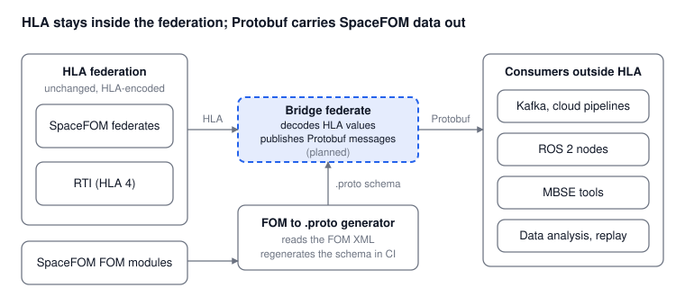

# SpaceFOM 2.0: a Protobuf schema for the SpaceFOM datatypes

**Proposed by** Gian Paolo Santopaolo · 17 November 2026 · for the SISO SpaceFOM 2.0 PDG

## Problem

SpaceFOM data can only be consumed by software that speaks HLA: reference frames, states and entities travel as HLA-encoded records (SISO-STD-018-2020 §8.7). A cloud pipeline, Kafka stream, ROS 2 node or MBSE/data-analysis tool that just wants a vehicle's state must hand-write decoders for every type, with no shared, versioned schema. HLA 4 defines its Federate Protocol services in Protobuf (SISO SIW 2026-028 §2.1), yet attribute values still travel inside as opaque `bytes` (IEEE 1516.1 `AttributeHandleValue`).

## Hypothesis and solution

The SpaceFOM datatypes map cleanly onto Protocol Buffers: SpaceFOM 1.0 uses only four basic representations and no variant records (§8.7.2). SpaceFOM 2.0 could therefore publish a `.proto` schema, generated mechanically from the FOM XML, alongside its FOM modules. The proposal has three parts:

- a deterministic FOM-to-proto mapping, as an informative annex;
- a reference generator that runs in CI, so the schema stays in step with the FOM, including 2.0 changes such as configurable time resolution;
- a reference bridge federate that republishes HLA updates as Protobuf on Kafka or gRPC.

Roles, synchronization and time management stay in HLA, which remains the source of truth inside the federation. The schema fits the [SpaceFOM 2 Product Nomination](https://www.sisostandards.org/resource/resmgr/forms_and_templates/siso-pn-038-draft__spacefom_.pdf) (SISO-PN-038), which already covers SISO Product Data Files such as XML schemas and lists its capabilities as "including, but not limited to"; the target is its circulation package, planned for 1 July 2027.

## Expected benefits

- SpaceFOM data becomes usable by MBSE, data-analysis, cloud and robotics tools, next to the existing SMP and FMI bridges.
- Any language with a Protobuf code generator gets typed SpaceFOM classes, so nobody writes HLA decoders by hand.
- It matches HLA 4, which already uses Protobuf for its services layer.
- Federation runs can be streamed, recorded and replayed with standard tooling.
- The change is additive: federates, the RTI and the compliance rules stay as they are.

## Implementation status

The work is open source at **[github.com/gsantopaolo/spacefom2-protobuf](https://github.com/gsantopaolo/spacefom2-protobuf)**. A [generator](https://github.com/gsantopaolo/spacefom2-protobuf/tree/main/generator) already turns the SpaceFOM 1.0 FOM XML into the [`siso.spacefom.v1` schema](https://github.com/gsantopaolo/spacefom2-protobuf/tree/main/proto/siso/spacefom/v1) with stable field numbers, and CI regenerates it and opens a pull request when the FOM changes. [Samples](https://github.com/gsantopaolo/spacefom2-protobuf/tree/main/samples) in C++, Python, Java, C#, TypeScript and Go decode the same data and are tested in CI. The bridge federate and a one-command Docker demo of a small SpaceFOM federation are planned ([technical briefing](https://github.com/gsantopaolo/spacefom2-protobuf/blob/main/docs/hearing/technical-briefing.md)).

## Who proposes it

**[Gian Paolo Santopaolo](https://www.linkedin.com/in/gianpaolosantopaolo/)**, Senior AI/ML Engineer at Alloy Therapeutics (headquartered in Waltham, MA, USA; based in Basel, Switzerland), a position reached through experience rather than a formal engineering degree, where he leads the design and deployment of conversational and agentic AI systems that let scientists work with proprietary research data. More than 20 years architecting and implementing highly available, highly scalable, distributed real-time systems worldwide; long-time Protocol Buffers user and speaker; former Microsoft Regional Director and Microsoft MVP. Available to present the idea with a working demo and to act as lead analyst for the PCR.

Prepared with Claude (Anthropic) as a research and drafting aid; every technical fact was checked against SISO-STD-018-2020 and the SpaceFOM FOM XML. I reviewed it and stand behind it. Details: [technical overview](https://github.com/gsantopaolo/spacefom2-protobuf/blob/main/docs/technical-overview.md) · [draft PCR](https://github.com/gsantopaolo/spacefom2-protobuf/blob/main/proposal/pcr-draft.md) · [verification](https://github.com/gsantopaolo/spacefom2-protobuf/blob/main/docs/verification.md).

