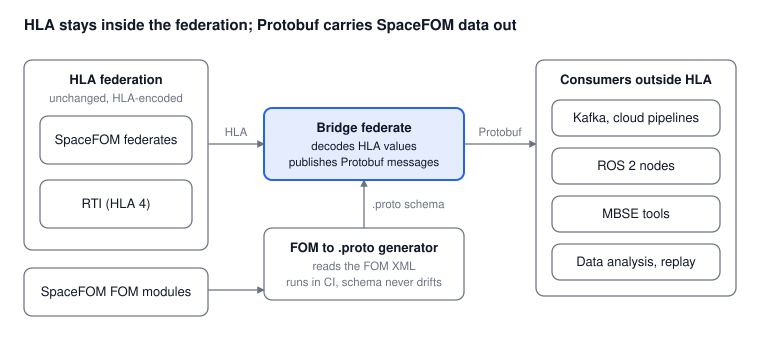

# SpaceFOM 2.0 Proposal: Protobuf Schema for SpaceFOM Datatypes

Gianpaolo Santopaolo · 17 November 2026

## Summary

SpaceFOM 2.0 should publish, alongside its FOM modules, a Protocol Buffers (`.proto`) schema of the SpaceFOM datatypes, generated mechanically from the FOM XML. It does not replace HLA: federation roles, synchronization and time management stay in HLA. It gives tools outside the HLA world (cloud pipelines, Kafka, ROS 2, MBSE and data-analysis tools) a standard, typed way to read and write SpaceFOM data.

## Problem

Today, SpaceFOM data can only be read by software that speaks HLA. The datatypes (reference frames, space-time coordinate states, physical and dynamical entities) are defined in the `SISO_SpaceFOM_datatypes`, `_environment` and `_entity` FOM modules and travel in HLA encoding (for example, big-endian `HLAfloat64BE` fields inside `HLAfixedRecord`s).

- **HLA 4 already uses Protobuf, but only for transport.** The new Federate Protocol (IEEE 1516.1-2025) defines the federate–RTI calls in official `.proto` files. The attribute values inside those calls are still HLA-encoded.
- **Consumers outside the federation must re-implement HLA decoding.** A cloud pipeline, a Kafka stream, a ROS 2 node or an MBSE/data-analysis tool that only wants to read a vehicle's state has to hand-write decoders for each SpaceFOM type, with no shared, versioned schema.
- **The result:** SpaceFOM simulation data stays locked inside HLA federations, which works against the goal of opening SpaceFOM to MBSE, data analysis and other industrial standards.

## Proposed solution

**Hypothesis:** the SpaceFOM datatypes map cleanly onto Protobuf, so a `.proto` schema can be generated from the FOM modules and kept in sync with them automatically.

1. **A deterministic FOM-to-proto mapping**, published as an annex of SpaceFOM 2.0:
    - HLA simple types → Protobuf scalars (`HLAfloat64BE` → `double`, `HLAinteger64BE` → `int64`, `HLAunicodeString` → `string`).
    - Fixed records → `message`s; fixed arrays (position, velocity vectors) → small vector messages; enumerations → `enum`s; variant records → `oneof`.
    - Object classes → one `message` per class, with all attributes optional, so a partial attribute update maps to a partial message.
    - Units and frames stay in the schema as comments and options, taken from the FOM's semantics fields.
2. **A reference generator** that reads the FOM XML and writes the `.proto` files, run in CI so the schema can never drift from the FOM.
3. **A reference bridge federate** that subscribes via HLA (or the HLA 4 Federate Protocol), converts HLA-encoded values to Protobuf, and publishes them to Kafka or gRPC.



The federation is untouched; the bridge and the generated schema are the only new parts.

Illustrative output for one SpaceFOM type (field names follow the FOM; to be checked against the 2.0 modules):

```protobuf
syntax = "proto3";
package siso.spacefom.v2;

message Vector3 { double x = 1; double y = 2; double z = 3; }
message AttitudeQuaternion { double scalar = 1; Vector3 vector = 2; }

message SpaceTimeCoordinateState {
  message Translational { Vector3 position = 1; Vector3 velocity = 2; }  // m, m/s
  message Rotational { AttitudeQuaternion attitude = 1; Vector3 angular_velocity = 2; }  // rad/s
  Translational translational_state = 1;
  Rotational rotational_state = 2;
  double time = 3;  // TT, truncated Julian date
}

message ReferenceFrame {
  optional string name = 1;
  optional string parent_name = 2;
  optional SpaceTimeCoordinateState state = 3;
}
```

**Out of scope:** replacing HLA, its RTI services, roles, synchronization or time management. The `.proto` describes the data only; HLA remains the source of truth inside the federation.

## Expected benefits

- **SpaceFOM data reaches beyond HLA.** Any tool with a Protobuf compiler (C++, Java, Python, Go, Rust, C#, TypeScript and more) gets typed SpaceFOM classes for free. This directly serves the strategic goal of opening SpaceFOM to MBSE, data analysis and other standards, next to the existing SMP and FMI bridges.
- **One schema, no hand-written decoders.** Generated from the FOM and checked in CI, the `.proto` is always in step with the standard and versioned with it.
- **Consistent with HLA 4.** It uses the same technology the Federate Protocol already adopted, so HLA 4 tool vendors and federate developers find nothing new to learn.
- **Built for streaming and storage.** Compact binary encoding, schema evolution rules and native Kafka/gRPC support make recording, replay and cloud analysis of federation runs straightforward.
- **Low cost and low risk.** It is additive: no change to existing federates, the RTI or compliance rules. It can start as an informative annex and become normative later if the group wishes.

## Proposed next steps

1. **Hearing:** present the idea to the PDG with a few slides and a working demo.
2. **Prototype:** a generator that produces `.proto` files from the published SpaceFOM 1.0 modules, plus a bridge federate streaming `ReferenceFrame` and `PhysicalEntity` updates from a sample federation to Kafka.
3. **Specification:** if the group agrees, draft the FOM-to-proto mapping rules as an annex for SpaceFOM 2.0 and track it as a change request (PCR).

Open question for the group: should the mapping also cover interaction classes and the management module, or start with the environment and entity data only?

## Proposer

**Gianpaolo Santopaolo** is a software engineer specialized in distributed systems, cloud infrastructure (Kubernetes, AWS EKS) and C#/.NET, currently a Senior AI Engineer in Lugano, Switzerland. He has used Protocol Buffers in production for many years, pushing them to their limits in high-throughput systems, and has given public talks on the subject. This contribution is made in a personal capacity.

_To complete: years of experience, notable systems or talks, and whether to name the employer as affiliation._

## References

1. [SISO-STD-018-2020, Space Reference FOM (SpaceFOM) 1.0](https://cdn.ymaws.com/www.sisostandards.org/resource/resmgr/standards_products/siso-std-018-2020_srfom.pdf)
2. Crues, Dexter, Falcone, Garro, Möller, ["SpaceFOM – A robust standard for enabling a-priori interoperability of HLA-based space systems simulations"](https://doi.org/10.1080/17477778.2021.1945962), Journal of Simulation 16(6), 2022
3. ["SpaceFOM: An Interoperability Standard for Space Systems Simulations"](https://ntrs.nasa.gov/api/citations/20210021609/downloads/SpaceFOM_IEEE_2022_Aeroconf.docx.pdf), IEEE Aerospace Conference 2022
4. ["SpaceFOM V2: The Next Generation in Space Simulation Interoperability and How You Can Help"](https://ntrs.nasa.gov/citations/20260008222), SISO SIMposium, Sept 2026
5. Möller et al., ["A Summary of Technical Updates in HLA 4 (IEEE 1516-2025)"](https://onearc.com/wp-content/uploads/2026/02/SISO_2026_SIW_028.pdf), SISO SIW 2026, paper 028 (Federate Protocol and Protobuf, section 2.1)
6. Federate Protocol implementations: [@hla4ts/proto](https://www.pkgstats.com/pkg:@hla4ts/proto), [VTMAK Python Federate Protocol](https://github.com/VTMAK/Python-Federate-Protocol), [Fora.Protocol](https://www.nuget.org/packages/fora.protocol)
