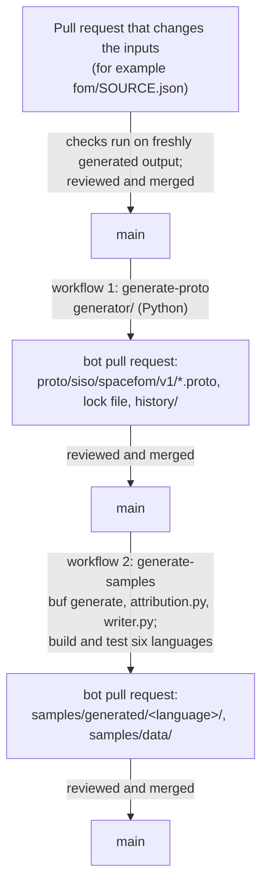

# SpaceFOM Protobuf samples

This folder holds code generated from the SpaceFOM `.proto` schema in six languages, with a small reader program and a test suite for each. The Python sample writes a set of data files, and all six readers decode the same files, so each language is checked against data it did not write.

| Language | Generated code | Sample and tests | Runtime library |
|---|---|---|---|
| C++ | [`generated/cpp`](generated/cpp) | [`cpp/`](cpp) (CMake, GoogleTest) | libprotobuf 36.2 |
| Python | [`generated/python`](generated/python) | [`python/`](python) (pytest) | `protobuf` 7.36.2 |
| Java | [`generated/java`](generated/java) | [`java/`](java) (Maven, JUnit) | `protobuf-java` 4.36.2 |
| C# | [`generated/csharp`](generated/csharp) | [`csharp/`](csharp) (.NET 10, xUnit) | `Google.Protobuf` 3.36.2 |
| TypeScript | [`generated/typescript`](generated/typescript) | [`typescript/`](typescript) (Node 26, `node:test`) | `@bufbuild/protobuf` 2.17.0 |
| Go | [`generated/go`](generated/go) | [`go/`](go) (`go test`) | `google.golang.org/protobuf` v1.36.12 |

The package names (`org.siso.spacefom.v1` in Java, `Siso.Spacefom.V1` in C#) are proposals. SISO has not published or approved them; see the [reference repository proposal](../proposal/reference-repository.md).

## How the pieces are produced

Two GitHub Actions workflows run one after the other. The first turns the FOM XML into `.proto` files. When those changes reach `main`, the second turns the `.proto` files into code for each language and tests it. Each workflow ends by opening a pull request, which is reviewed before it is merged. A FOM change therefore reaches the samples through three merges:



1. [`generate-proto`](../.github/workflows/generate-proto.yml) runs when `fom/`, `generator/`, `buf.yaml` or its own file changes on `main`. It downloads the pinned FOM modules, runs the generator, validates the result (`protoc`, tests, `buf lint`, `buf breaking`) and opens a pull request that updates `proto/`.
2. [`generate-samples`](../.github/workflows/generate-samples.yml) runs when `proto/` or `samples/` changes. Merging the first pull request changes `proto/`, so the second workflow starts by itself. It runs `buf generate` with [`buf.gen.yaml`](buf.gen.yaml) and `attribution.py`, rewrites the data files, builds and tests all six languages in parallel, and opens a pull request that updates `samples/generated/` and `samples/data/`.

On a pull request, each workflow regenerates its output and runs every check on the fresh result, but opens nothing. A pull request that changes only the inputs passes even though its committed output is now out of date; the run summary says the bot will regenerate it after the merge. A pull request that edits generated files by hand fails if they don't match what the generator produces. [`tools/generated_output_check.py`](../tools/generated_output_check.py) makes that decision and has its own tests. On branches other than `main`, each workflow runs as a dry run and opens no pull request. You can also start either one by hand from the Actions tab, with a `dry_run` option.

## What the code does

- [`buf.gen.yaml`](buf.gen.yaml) lists one code generator per language. `protoc`'s built-in generators cover C++, Java, C# and Python; `protoc-gen-go` covers Go and `protoc-gen-es` covers TypeScript. Buf's managed mode adds the Java package and Go import path at generation time, so the `.proto` files carry no language-specific options.
- [`attribution.py`](attribution.py) runs right after `buf generate`. protoc keeps the `.proto` header comment for Go and TypeScript but drops it for C++, Java, C# and Python, so this script adds the SISO attribution line to every generated file that lacks it. It changes nothing on a second run, so regeneration stays byte-identical.
- [`python/writer.py`](python/writer.py) builds five messages: a root and a child `ReferenceFrame`, a `DynamicalEntity`, an `ExecutionConfiguration` and a `ModeTransitionRequest`. It writes each one to [`data/`](data) as protobuf binary (`.binpb`), plus a `.json` copy you can read.
- The readers (`python/reader.py`, `go/main.go`, `typescript/reader.ts`, `java/src/main/java/Reader.java`, `csharp/Reader/Reader.cs`, `cpp/checks.cpp`) decode those files and check every value. They cover strings and doubles, the 9-element inertia matrix, enums, an empty `parent_name` that must still count as present, and an unset `torque` that must stay absent. The readers are short and look alike, so you can compare how each language handles the same message.
- The tests in each language run three kinds of check:
  - the reader checks above;
  - for each of the 18 generated message types, set every field, serialize, parse and compare (they find the types through protobuf reflection, so a missing type or field fails the test);
  - the enum values, including the `MTR_MODE_UNSPECIFIED = 0` value that the generator adds to `MTRMode`.

C# drops an enum value's prefix when it matches the enum's name, so `MTR_MODE_UNSPECIFIED` becomes `MTRMode.Unspecified` while `MTR_GOTO_RUN` becomes `MTRMode.MtrGotoRun`. TypeScript code is generated as JavaScript plus `.d.ts` files, because Node runs TypeScript by stripping types and does not accept TypeScript `enum` declarations.

## Running it yourself

From the repository root, with protoc 36.2, buf, `protoc-gen-go` v1.36.12, Python 3.11+, Go, Node 26, Java 17+ with Maven, .NET 10+ and CMake installed:

```sh
(cd samples && npm ci)           # protoc-gen-es and the TypeScript runtime
pip install -r samples/python/requirements.txt
sh samples/test-all.sh           # regenerate, then build and test all six languages
```

To run one language, use the commands in [`test-all.sh`](test-all.sh). The C++ build uses an installed protobuf 36.2 if it finds one. Otherwise it builds protobuf from source, which takes a few minutes the first time. C++ needs this exact version, because protobuf requires "an exact match between the generated code version and the runtime version" for C++ ([cross-version runtime guarantee](https://protobuf.dev/support/cross-version-runtime-guarantee/)). The other languages accept a runtime of the same version or newer, up to the next major version.

Generated code is derived from the SpaceFOM FOM modules: Reprinted with permission from SISO Inc.
